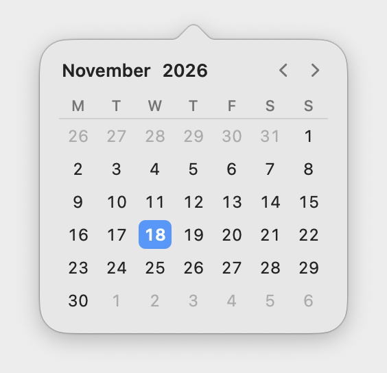
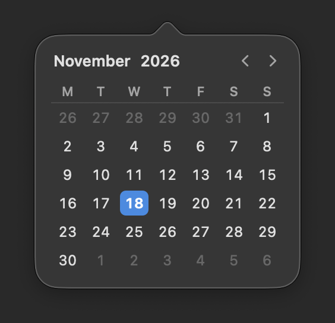
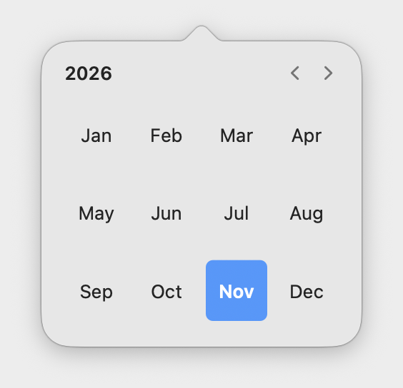
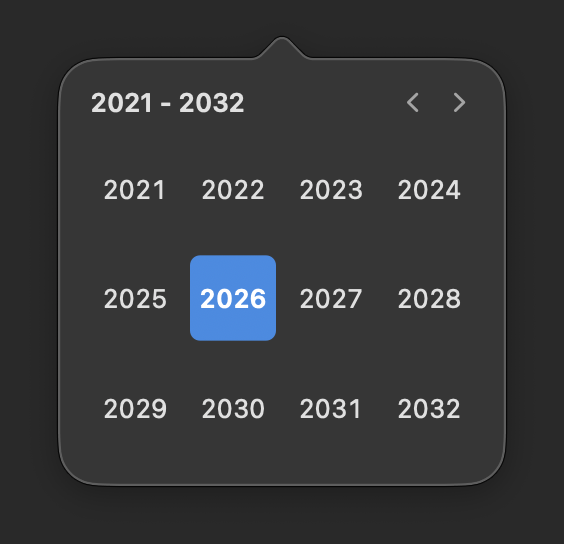

# macOS Menu Bar Calendar 📅

A tiny calendar that lives in your Mac menu bar. Click the icon, see the month, click away. That's the whole app.

If you've come from Windows, it's the calendar you get by clicking the clock in the taskbar: a quick look at the month and nothing else. macOS doesn't have one out of the box, and it's surprising how much you miss it. 🪟

It's deliberately small. If all you want is a quick glance at "what's the date on Thursday week?", this is for you.

| Light | Dark |
| --- | --- |
|  |  |

## ✨ What it does

- Shows a calendar-page icon in the menu bar: <picture><source media="(prefers-color-scheme: dark)" srcset="docs/screenshots/menu-bar-icon-dark.png"></picture>
- Click it for a popover with the current month. Today is highlighted in blue.
- Click the month name to pick a month, or the year to pick a year.
- Follows the system light or dark theme, always. No setting for it.
- Starts the week on whatever day your macOS region settings say.
- The app icon is the same calendar on a blue tile, drawn from the same vector shape at every size when you build.
- The first time it starts, it asks whether to open at login (yes, please 🙋). Right-click the icon to change your mind later, or to quit.
- Speaks English, German, French, Spanish, Dutch and Danish. Month and day names follow your Mac's language and region.

### 🔭 Zooming out

Click **November** to see the twelve months of the year. Click **2026** to see twelve years: five before, the current one and six after. Pick a year to see its months, and a month to get back to its days.

| Months | Years |
| --- | --- |
|  |  |

Every time you open the calendar it starts on this month with today selected, wherever you left it.

### ⌨️ Getting around

| Action | How |
| --- | --- |
| Back / forward | `‹` `›` buttons, scroll wheel, Page Up / Page Down. A month at a time on days, a year on months, six years on years |
| Move the selected day | Arrow keys |
| Close | `Esc` or click anywhere else |

## 🙅 What it doesn't do

On purpose: no calendar events, no adding events, no "open in Calendar" link, no clock or date text in the menu bar, no themes, no preferences window, no auto-updater, no global shortcut. Fewer moving parts, nothing to configure, no permissions to grant.

## 🛠️ Build and install

You need macOS 13 or later. Full Xcode is not required, just the Command Line Tools.

```sh
xcode-select --install  # Command Line Tools; says "already installed" if you have them
./build.sh --install    # builds the app, copies it to /Applications and launches it
```

Run `./build.sh` on its own to build `build/MenuBarCalendar.app` without installing.

The app is ad-hoc signed, which is fine for running on your own Mac.

## 🐛 Gotchas

- `swift build` prints a couple of `search path ... not found` linker warnings with the Command Line Tools. They're harmless, and `build.sh` hides them.
- If your menu bar is crowded, a notched MacBook can hide new icons behind the notch. Cmd-drag icons around to make room.

## 🎨 Credits

The calendar icon, in the menu bar and as the app icon, is adapted from `calendar3` in [Bootstrap Icons](https://icons.getbootstrap.com/), used under the MIT licence. A copy of that licence is in [Support/Licenses/bootstrap-icons.txt](Support/Licenses/bootstrap-icons.txt) and ships inside the app.

## 🤝 Contributing

Keep it small. If a feature needs a preferences window, it probably doesn't belong here.

Changes go in through pull requests. CI runs `./scripts/coverage.sh`, which needs 100% unit test coverage before anything can merge, so run it locally first.
